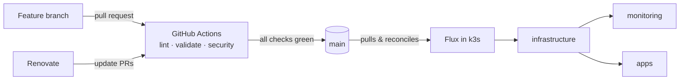

# caesarlabs

[](https://github.com/juvradev/caesarlabs/actions/workflows/validate.yaml)
[](https://github.com/juvradev/caesarlabs/actions/workflows/security.yaml)
[](https://github.com/juvradev/caesarlabs/issues)

GitOps repository for my homelab. A single-node **k3s** cluster, fully managed by **FluxCD**,
with this repository as the **single source of truth**: if it is not in Git, it does not exist.

---

## ✨ Tech stack

| Area               | Tool                                                      |
|--------------------|-----------------------------------------------------------|
| Kubernetes         | [k3s](https://k3s.io)                                     |
| GitOps / CD        | [FluxCD](https://fluxcd.io)                               |
| Packaging          | [Helm](https://helm.sh) + [Kustomize](https://kustomize.io) |
| Ingress            | [Traefik](https://traefik.io)                             |
| Certificates       | [cert-manager](https://cert-manager.io) + Let's Encrypt (DNS-01 via Cloudflare) |
| Secrets            | [SOPS](https://github.com/getsops/sops) + [age](https://github.com/FiloSottile/age) |
| Metrics & alerting | Prometheus, Alertmanager, Grafana (kube-prometheus-stack) |
| Logging            | Loki + Grafana Alloy                                      |
| CI                 | GitHub Actions                                            |
| Dependency updates | [Renovate](https://docs.renovatebot.com)                  |
| Container images   | GitHub Container Registry (GHCR)                          |

---

## 🔁 How it works



1. Every change starts on a short-lived branch (`feat/…`, `fix/…`, `chore/…`).
2. A pull request triggers the CI checks: `yamllint`, `kustomize build` + `kubeconform`, `gitleaks` and a SOPS encryption check.
3. After a squash merge into `main`, Flux applies the change to the cluster.
4. Rollbacks are done with `git revert`, never with manual `kubectl` changes.

---

## 📁 Repository structure

```
├── .github/          # CI workflows & Renovate config
├── clusters/         # Flux entry point per cluster
├── infrastructure/   # Traefik, cert-manager, ClusterIssuers
├── monitoring/       # Prometheus, Grafana, Loki, Alloy, dashboards, alerts
├── apps/             # Applications (one namespace per app)
├── charts/           # Custom Helm charts
├── docs/             # Bootstrap guide, network & secrets docs
└── scripts/          # Helper scripts for local use and CI
```

Deployment order is enforced by Flux `dependsOn`:
**infrastructure → monitoring / apps**.

A detailed explanation can be found in [`docs/`](docs/).

---

## 🛠️ Local setup

**Required tools**

```bash
brew install git gh kubectl helm kustomize fluxcd/tap/flux sops age yamllint kubeconform gitleaks pre-commit
```

**Enable pre-commit hooks** (once per clone)

```bash
pre-commit install
```

**Validate manifests locally**

```bash
./scripts/validate.sh
```

---

## 🔐 Secrets

Secrets are stored **encrypted** in Git using SOPS + age. Only values (`data` / `stringData`)
are encrypted; metadata stays readable. Flux decrypts them inside the cluster.

```bash
# create or edit a secret
sops edit apps/<app>/secret.sops.yaml
```

- Encrypted files **must** end with `.sops.yaml`.
- The age private key is **never** committed and is backed up outside this repository.

More details: [`docs/secrets.md`](docs/secrets.md)

---

## 🗺️ Roadmap

- [x] Repository setup (SOPS, yamllint, pre-commit)
- [x] CI pipelines (validate & security)
- [x] Branch protection & Renovate
- [x] Let's Encrypt ClusterIssuers (staging & prod)
- [ ] Traefik & cert-manager
- [ ] kube-prometheus-stack
- [ ] Loki & Alloy
- [ ] Flux & Alertmanager notifications
- [ ] Server setup & Flux bootstrap
- [ ] First applications
- [ ] Backup strategy for persistent volumes
